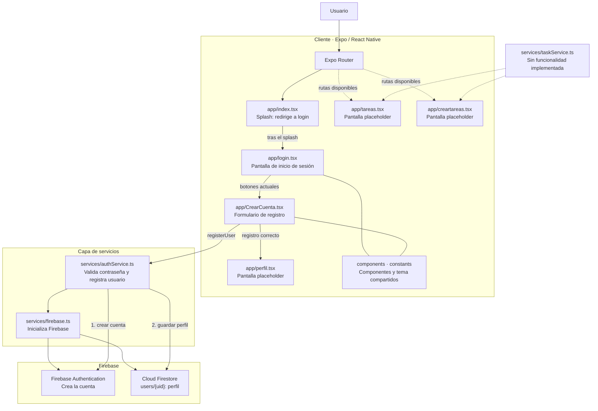

# Arquitectura actual

## Alcance del diagrama

- El arranque muestra el splash y después siempre redirige a `login`.
- El formulario de registro valida los datos, crea la cuenta en Firebase Authentication y guarda el perfil en Firestore.
- La pantalla de inicio de sesión todavía no está conectada a Firebase; sus botones navegan actualmente al formulario de registro.
- Las pantallas de perfil y tareas son placeholders. `taskService.ts` no implementa operaciones de tareas.
